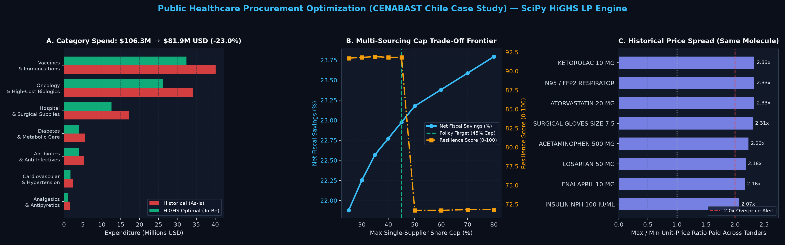
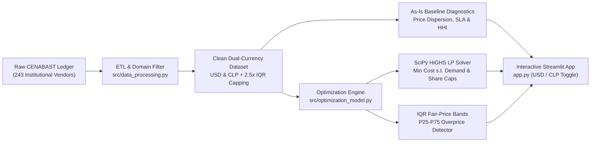

# 🏥 Public Healthcare Procurement & Supply Chain Optimization

[](https://github.com/ayalaphysds/healthcare-procurement-optimization/actions/workflows/ci.yml)
[](https://www.python.org/downloads/)
[-00599C.svg)](https://highs.dev/)
[](https://streamlit.io/)
[](https://plotly.com/)
[](https://docs.astral.sh/ruff/)
[](LICENSE)

> **End-to-End Operations Research, Data Engineering & Decision-Support Platform** that optimizes centralized public pharmaceutical procurement, eliminates tender overpricing, and prevents hospital drug stockouts—modeled on real institutional supplier data from **CENABAST** (Chile's National Health Supply Center).



---

## 🌎 Context for International Reviewers: Why This Project Exists & Why It Matters

### What is CENABAST?
In Chile, roughly **80% of the population (~16M+ residents)** relies on the public healthcare network insured by **FONASA** (*National Health Fund*). At the operational core of that system sits **CENABAST** (*Central de Abastecimiento del Sistema Nacional de Servicios de Salud*), the centralized federal procurement and distribution agency under Chile's Ministry of Health (**MINSAL**).

For international readers, **CENABAST** is analogous to a national-scale **Healthcare Group Purchasing Organization (GPO)** combined with the **US Veterans Affairs National Acquisition Center (VA NAC)** or **UK NHS Supply Chain**:
- It intermediates over **$1.13 Billion USD (~1.07 Trillion CLP)** in registered vendor procurement volume across **243 institutional suppliers** (including *Pfizer, Roche, Novartis, Sanofi, AstraZeneca, AbbVie, Bayer, GSK, Merck, Sandoz, Fresenius Kabi, Baxter*, and major Latin American laboratories).
- It supplies essential chronic-care generics, antibiotics, vaccines, high-cost oncology biologics, and critical surgical consumables to public hospitals and municipal primary-care pharmacies nationwide.

### What Real-World Problem Does This Solve?
Public healthcare systems—and large enterprise procurement organizations globally—face a costly structural trilemma:
1. **Severe Unit-Price Dispersion (Fiscal Leakage):** Uncoordinated or decentralized tender lots end up paying **2.0x to 2.4x different unit prices** to competing manufacturers for the **exact same generic active ingredient and dosage**.
2. **Single-Winner Stockout Fragility (Patient Safety Risk):** Traditional lowest-bidder tenders award **100% of a critical drug's volume to a single supplier** (`HHI = 10,000`). When that vendor suffers an active pharmaceutical ingredient (API) shortage, quality hold, or import delay (**>25% of historical orders experience SLA delays**), public hospitals face immediate life-threatening medication stockouts.
3. **Manual Post-Mortem Auditing:** Overpriced bids are typically discovered *after* contracts are executed rather than prevented by statistical price bands before award.

### Real-World Utility & Global Transferability
This platform replaces winner-take-all procurement heuristics with:
- **Preventive Statistical Governance:** Empirical Interquartile Range (`P25`–`P75`) **Fair-Price Bands** that automatically flag overpriced bids prior to contract award.
- **Constrained Linear Programming (`SciPy HiGHS`):** A sub-50ms mathematical optimization engine that simultaneously minimizes fiscal expenditure, guarantees **100% hospital demand coverage**, enforces **anti-monopoly split-award caps ($\le 45\%$ per supplier per medication)** so every critical drug is backed by **3 qualified suppliers**, and screens vendors by **historical logistics SLA reliability**.
- **Beyond Public Health:** While anchored in Chilean transparency data (`1 USD ≈ 950 CLP`, with a **1-click `USD` / `CLP` currency toggle** in the app), the exact engine generalizes to **US/EU hospital GPOs, pharmacy benefit managers (PBMs), retail supply chains, and B2B strategic sourcing platforms**.

> 📖 *For a full glossary of Chilean institutional terms (`CENABAST`, `FONASA`, `MINSAL`, `RUT`, `CLP`), hybrid data provenance notes, and mathematical proofs, see [`docs/international_context_and_methodology.md`](docs/international_context_and_methodology.md).*

---

## 💻 Software & ML/OR Engineering Highlights

This repository is engineered as a production-grade showcase across four disciplines:

- **Typed ETL & Domain Data Cleaning (`src/data_processing.py`):** Ingests raw semicolon-delimited UTF-8-BOM Spanish government disclosures (`243` vendors), applies deterministic entity classification to filter out internal agency op-ex vendors (postal, security, staff childcare, IT, fuel) down to **166 qualified pharmaceutical & medical supply companies**, performs per-molecule `2.5x IQR` soft winsorization, and outputs clean dual-currency (`USD` & `CLP`) schemas.
- **High-Performance Operations Research (`src/optimization_model.py`):** Formulates multi-supplier tender clearing as a compact Linear Program solved via the C++ **HiGHS** dual-simplex/interior-point solver (`scipy.optimize.linprog`). Encodes split-award limits directly as variable box bounds `(0, alpha * D_i)` with mathematical feasibility guards (`ceil(1 / alpha)`) for instant interactive re-optimization.
- **Interactive Executive Decision-Support App (`app.py`):** 5-tab **Streamlit + Plotly** web application featuring live `USD ($)` / `CLP ($)` currency conversion, real-time HiGHS scenario sliders, exact category-level LP attribution, P25–P75 price-band audits, supplier SLA risk bubble charts, and one-click CSV contract schedule export.
- **Automated Verification & CI/CD (`tests/`, `.github/workflows/ci.yml`):** **14 automated `pytest` tests** verifying ETL determinism, IQR outlier capping, exact LP demand conservation ($\sum_j x_{ij} = D_i$), anti-monopoly share bounds, and headless **Streamlit `AppTest`** UI rendering—enforced via **Ruff** linting and **GitHub Actions** across Python 3.11 and 3.12.

---

## 📊 Verified Benchmark Results (`As-Is` vs. `To-Be`)

Evaluated across an 18-item essential formulary (`1,600` purchase orders; reference FX `1 USD = 950 CLP`; policy cap $\alpha = 45\%$, SLA cutoff $\tau = 70$):

| Key Metric | Historical Baseline (`As-Is`) | HiGHS LP Optimal (`To-Be`) | Verified Impact |
| :--- | :---: | :---: | :---: |
| **Evaluated Portfolio Spend (USD)** | $106.32M USD | **$81.89M USD** | **-$24.43M USD Saved** |
| **Evaluated Portfolio Spend (CLP)** | $101,000M CLP | **$77,796M CLP** | **-$23,204M CLP Saved** |
| **Net Fiscal Savings** | 0.00% | **22.97%** | **+22.97% Cost Efficiency** |
| **Max Single-Supplier Share / Drug** | Up to 100% (Single-Winner) | **Capped at $\le 45.0\%$** | **3.00 Active Suppliers / Drug** |
| **Tender-Level Concentration (HHI)** | 10,000 pts (Monopoly Lot) | **4,142 pts (Split Award)** | **-58.6% Monopoly Risk** |
| **Global Portfolio HHI** | 519.5 pts | **704.4 pts** | **Competitive (< 1,500 DOJ/FTC)** |
| **Awarded Unit-Price Dispersion (CV)** | 20.44% | **1.09%** | **Price Standardization** |
| **Supply Chain Resilience Score** | 51.9 / 100 | **91.8 / 100** | **+76.9% Stockout Resilience** |

---

## 🏗️ System Architecture & Mathematical Model



### Linear Programming Formulation
For medications $i \in \{1, \dots, N\}$ with clinical demand $D_i$ and SLA-qualified suppliers $j \in \{1, \dots, M\}$ offering unit price $c_{ij}$:

$$\min_{x \ge 0} \sum_{i=1}^{N} \sum_{j=1}^{M} c_{ij} \, x_{ij}$$

$$\text{s.t.} \quad \sum_{j=1}^{M} x_{ij} = D_i \;\; \forall i, \qquad 0 \le x_{ij} \le \alpha D_i \;\; \forall i,j, \qquad \sum_{i=1}^{N} x_{ij} \le \text{Cap}_j \;\; \forall j$$

---

## 📂 Repository Structure

```text
healthcare-procurement-optimization/
├── .github/workflows/ci.yml                        # GitHub Actions CI (Ruff + Pytest on Python 3.11 & 3.12)
├── data/
│   ├── raw/
│   │   ├── cenabast_suppliers_2026_raw.csv         # Authentic institutional CENABAST vendor ledger (243 entities)
│   │   └── procurement_transactions_raw.csv        # Disaggregated public tender line-items
│   └── processed/
│       └── clean_procurement_data.csv              # Standardized dual-currency (USD/CLP) analytical dataset
├── docs/
│   ├── assets/optimization_overview.png            # Executive 3-panel summary chart
│   └── international_context_and_methodology.md    # International healthcare context, glossary & LP math guide
├── notebooks/
│   └── procurement_eda_and_optimization.ipynb      # Executed EDA, price-band audit & Pareto sensitivity frontier
├── reports/
│   └── executive_report.md                         # Formal executive policy & financial impact brief (USD & CLP)
├── src/
│   ├── __init__.py
│   ├── config.py                                   # FX constants, typed catalog dataclasses & domain entity filters
│   ├── data_processing.py                          # Reproducible CLI ETL pipeline & 2.5x IQR winsorizer
│   └── optimization_model.py                       # ProcurementOptimizer: As-Is KPIs, Fair-Price Bands & HiGHS LP
├── tests/
│   ├── test_data_processing.py                     # ETL schema, entity filtering & IQR outlier unit tests
│   ├── test_optimization_model.py                  # LP demand conservation, share caps & HHI property tests
│   └── test_app_smoke.py                           # Headless Streamlit AppTest UI & slider integration tests
├── app.py                                          # Interactive Streamlit + Plotly decision-support dashboard
├── pyproject.toml                                  # Python package metadata, pytest & ruff configuration
├── requirements.txt                                # Runtime & test dependencies
└── LICENSE                                         # Intellectual property & portfolio copyright notice
```

---

## ⚡ Quickstart: Installation & Local Execution

### 1. Clone the Repository
```bash
git clone https://github.com/ayalaphysds/healthcare-procurement-optimization.git
cd healthcare-procurement-optimization
```

### 2. Create a Virtual Environment & Install Dependencies
```bash
# Windows (PowerShell)
python -m venv .venv
.\.venv\Scripts\Activate.ps1

# Linux / macOS
python3 -m venv .venv
source .venv/bin/activate

pip install -r requirements.txt
```

### 3. Run the ETL Pipeline & Optimization Engine (CLI)
```bash
python src/data_processing.py
python src/optimization_model.py
```

### 4. Run the Automated Test Suite
```bash
pytest
```

### 5. Launch the Interactive Dashboard
```bash
streamlit run app.py
```
> Open `http://localhost:8501` in your browser. Use the sidebar **Display Currency (`USD` / `CLP`)** toggle and **Optimization Constraints** sliders to simulate real-time procurement policies and export optimal award schedules as CSV.

---

## 👤 Author

- **Sebastián Eduardo Ayala Vásquez** (`ayala.phys.ds`)
- **Focus:** Senior Python Engineer | Machine Learning, Operations Research & Data Systems
- **GitHub:** [@ayalaphysds](https://github.com/ayalaphysds)
- **Email:** [ayala.phys.ds@gmail.com](mailto:ayala.phys.ds@gmail.com)

---

⚠️ **Intellectual Property Notice:** This repository is published as an open-view software engineering and operations research portfolio case study for technical evaluation and recruitment purposes. Copyright © 2026 Sebastián Eduardo Ayala Vásquez. All rights reserved. Commercial redistribution or unauthorized derivative use is not permitted without prior written consent.
