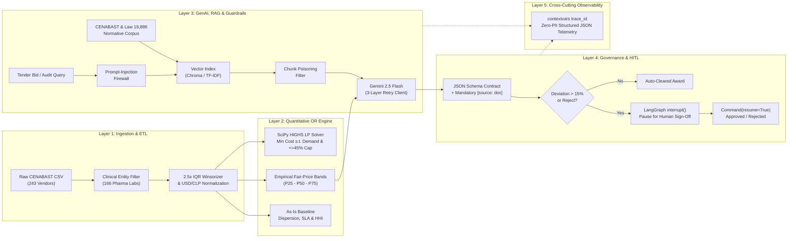

# 🏗️ System Architecture, Infrastructure Stack & AI Evolution Blueprint

> **Purpose of This Document:** Provides a complete, interview-ready technical breakdown of:
> 1. **What the CENABAST System Does** — both in its **Original Version (Phase 1: Quantitative Operations Research & Statistical Data Engineering)** and in its **AI-Augmented Version (Phase 2: Generative AI, Regulatory RAG, Guardrails & Human-in-the-Loop Orchestration)**.
> 2. **What Infrastructure the Code Uses** — across compute/runtime, data/vector persistence, mathematical & AI engines, network transport, security/observability, CI/CD, and cloud deployment.
> 3. **How the Layered Software Architecture Works End-to-End** — component boundaries, data contracts, error handling, and design trade-offs.

---

## 1. Two-Stage Evolution: Original Program vs. AI Specialization Upgrade

A core strength of this system is its **Hybrid Quantitative + Generative AI (Neuro-Symbolic) Architecture**. Rather than asking a Large Language Model (LLM) to guess linear algebra or invent drug prices, each paradigm handles what it is mathematically best at:

| Dimension | Phase 1: Original Version (Quantitative OR & Data Engineering) | Phase 2: AI Course Upgrade (GenAI, RAG, Guardrails & HITL) |
| :--- | :--- | :--- |
| **Core Problem Solved** | Eliminates **2.0x–2.4x unit-price dispersion** across 243 CENABAST suppliers and prevents **single-winner hospital stockouts** across an `$106.32M USD` (`$101,000M CLP`) essential drug formulary. | Automates **regulatory compliance auditing**, **unstructured tender document Q&A**, **explainable overpricing rulings**, and **Human-in-the-Loop (HITL) governance** before contracts are signed. |
| **Primary Engine** | **Constrained Linear Programming (`SciPy HiGHS` C++ solver)** + **Empirical `P25–P75` Interquartile Fair-Price Bands** + **Herfindahl-Hirschman Index (HHI)** antitrust metrics. | **Google Gemini (`gemini-2.5-flash`) REST API** + **Vector RAG (`ChromaDB` / `RegulatoryVectorIndex`)** + **LangChain LCEL Routing** + **LangGraph Stateful `interrupt` / `resume` Supervision**. |
| **Inputs** | Structured CSV disclosures (`cenabast_suppliers_2026_raw.csv`, `1,600` purchase orders across 18 WHO/CENABAST essential medications). | Unstructured legal & technical rules (`Law 19,886`, CENABAST split-award directives, hospital cold-chain SLA manuals) + structured tender bids. |
| **Outputs** | Exact optimal multi-supplier allocation schedule (`$24.43M USD` / `22.97%` net savings, `<= 45%` max share cap, `3.0` suppliers/drug, `91.8/100` resilience score). | **JSON Schema Draft 2020-12** downstream contract (`overprice_detected`, `deviation_pct`, `recommendation`, `ruling`, mandatory `[source: <doc>]` citations) + HITL approval state. |
| **Key Code Modules** | [`src/config.py`](../src/config.py), [`src/data_processing.py`](../src/data_processing.py), [`src/optimization_model.py`](../src/optimization_model.py), [`app.py`](../app.py) (Tabs 1–5). | [`src/ai_auditor.py`](../src/ai_auditor.py), [`app.py`](../app.py) (Tab 6), plus full specialization deliverables in `Curso-CCHIA` (`Gate 1/` & `Gate 2/`). |

---

## 2. What Infrastructure Does the Code Use? (Complete Stack Breakdown)

When explaining **"what infrastructure the code uses"** in a technical interview, separate the answer into **6 concrete infrastructure tiers**:

```mermaid
flowchart TB
    subgraph Tier1["1. Compute & Runtime Environment"]
        PY["Python 3.11 / 3.12 Runtime<br/>Isolated Virtualenv (.venv) + pyproject.toml"]
        ENV["Secret & Config Management<br/>python-dotenv (.env excluded via .gitignore)"]
    end

    subgraph Tier2["2. Data & Vector Storage Infrastructure"]
        CSV["Structured Columnar Flat-File Store<br/>data/raw/ (UTF-8-BOM) & data/processed/ (USD/CLP CSV)"]
        VEC["Vector Knowledge Store<br/>ChromaDB Persistent Index (indice_gate2/) & In-Memory TF-IDF Vector Index"]
    end

    subgraph Tier3["3. Mathematical & AI Compute Engines"]
        HIGHS["C++ HiGHS Linear Programming Solver<br/>(via scipy.optimize.linprog — Dual Simplex / Interior Point)"]
        GEMINI["External Managed LLM Infrastructure<br/>Google Gemini API (gemini-2.5-flash via HTTPS REST v1beta)"]
    end

    subgraph Tier4["4. Network Transport, Orchestration & Governance"]
        RETRY["3-Layer Resilient HTTP Client<br/>Fail-Fast (400/401/403) vs. Exponential Backoff Retry (429/500/503)"]
        ORCH["LCEL Conditional Router + LangGraph StateGraph<br/>Checkpointed Human-in-the-Loop (interrupt / Command(resume=True))"]
        SEC["Security & Telemetry Layer<br/>Regex Prompt-Injection Firewall + contextvars trace_id Zero-PII JSON Logs"]
    end

    subgraph Tier5["5. Presentation & API Serving Layer"]
        ST["Streamlit Reactive Web Server (Port 8501)<br/>+ Plotly WebGL/SVG Interactive Charts"]
        SCHEMA["Downstream Microservice Contract<br/>JSON Schema Draft 2020-12 / Pydantic v2 / FastAPI-Ready"]
    end

    subgraph Tier6["6. CI/CD & Quality Assurance Infrastructure"]
        GHA["GitHub Actions Cloud Runners (ubuntu-latest)<br/>Matrix Build: Python 3.11 & 3.12"]
        QA["Ruff Static Linter + Pytest Suite (19 Tests)<br/>+ Headless Streamlit AppTest UI Runner"]
    end

    Tier1 --> Tier2 --> Tier3 --> Tier4 --> Tier5 --> Tier6
```

### Detailed Infrastructure Inventory

1. **Compute & Runtime Environment:**
   - **Language & Packaging:** Python `3.11` and `3.12` managed via PEP 621 [`pyproject.toml`](../pyproject.toml) and isolated virtual environments (`.venv`).
   - **Configuration & Secrets:** Environment-variable injection (`GEMINI_API_KEY` via `.env` and `os.getenv`), strictly excluded from version control via [`.gitignore`](../.gitignore), paired with a deterministic offline synthesizer so local development and CI pipelines run with **zero external cloud credentials required**.
2. **Data & Vector Storage Layer:**
   - **Structured Transactional Storage:** File-based ETL lakehouse pattern (`data/raw/` for immutable semicolon-delimited UTF-8-BOM Chilean government disclosures; `data/processed/` for cleaned, IQR-winsorized dual-currency `USD`/`CLP` analytical tables processed in-memory with `Pandas 2.x/3.x` and `NumPy`).
   - **Unstructured Vector Storage (RAG):** Persistent **ChromaDB** local vector database (`indice_gate2/` in `Curso-CCHIA/Gate 2`) and deterministic cosine-similarity vector index ([`RegulatoryVectorIndex`](../src/ai_auditor.py)) storing chunked normative documents (`Law 19,886`, CENABAST multi-supplier directives, cold-chain SLA standards).
3. **Mathematical & AI Compute Engines:**
   - **Operations Research Solver:** **HiGHS** (`scipy.optimize.linprog(method="highs")`), a high-performance open-source C++ Linear Programming engine executing dual-simplex and interior-point algorithms in `<50ms` per scenario.
   - **Generative AI Foundation Model:** **Google Gemini API (`gemini-2.5-flash`)** consumed over HTTPS REST (`generativelanguage.googleapis.com/v1beta`), selected via empirical latency-vs-cost ADR benchmarking (`comparar_modelos.py`: `$0.15 / 1M` input tokens, `$0.60 / 1M` output tokens, `<1.2s` p50 latency).
4. **Network Resilience, Orchestration & Security Infrastructure:**
   - **3-Layer HTTP Transport (`cliente_api` $\to$ `cliente_reintento` $\to$ `cliente` / [`with_retry`](../src/ai_auditor.py)):** Uses `requests` / `urllib.request` with explicit timeout controls and HTTP status classification:
     - `HTTP 400 / 401 / 403` (bad schema or invalid API key) $\to$ raises `ValueError` immediately (**fail-fast**, zero wasted retries).
     - `HTTP 408 / 429 / 500 / 502 / 503 / 504` (rate limits or transient provider errors) $\to$ raises `TimeoutError`, intercepted by `with_retry()` using **exponential backoff** before escalating to `RuntimeError` if all attempts fail.
   - **Agentic & Stateful Orchestration:** **LangChain Expression Language (LCEL)** (`RunnableBranch` semantic routing) and **LangGraph** (`StateGraph` with `MemorySaver` checkpointer and `interrupt()` / `Command(resume=True)` for Human-in-the-Loop state persistence).
   - **Security & Observability:** Input/chunk regex firewall ([`validate_query`](../src/ai_auditor.py), [`filter_suspicious_chunks`](../src/ai_auditor.py)) + Python `contextvars.ContextVar` distributed `trace_id` logger ([`log_telemetry_event`](../src/ai_auditor.py)) that strips PII and raw prompts before emitting JSONL telemetry.
5. **Presentation & Downstream Interface Layer:**
   - **Interactive Web Server:** **Streamlit** (`app.py`, port `8501`) with `@st.cache_data` in-memory caching and **Plotly** interactive charts.
   - **Downstream Interoperability Contract:** **JSON Schema Draft 2020-12** & **Pydantic v2** models (`TenderAuditResult.to_contract_dict()`), ready to be served behind a **FastAPI** REST microservice in a **Docker** container (Module 3 Capstone target).
6. **CI/CD & Automated Verification Infrastructure:**
   - **GitHub Actions Cloud Runners (`ubuntu-latest`):** Executes [`.github/workflows/ci.yml`](../.github/workflows/ci.yml) on every `push` and `pull_request` across a **Python 3.11 & 3.12 matrix**.
   - **Quality Gates:** **Ruff** static analysis (`ruff check src/ tests/ app.py`) + **Pytest** (`19` automated tests covering ETL determinism, IQR outlier capping, LP demand conservation, RAG citation enforcement, prompt-injection blocking, 3-layer retry classification, HITL `interrupt`/`resume`, and headless **Streamlit `AppTest`** UI rendering).

---

## 3. End-to-End Layered Software Architecture

---

## 4. Key Architectural Design Decisions (ADRs) for Technical Interviews

### ADR-01: Why Combine Linear Programming (`HiGHS`) with Generative AI (`RAG`) Instead of Using an LLM Alone?
- **Problem:** LLMs are probabilistic next-token predictors; they hallucinate arithmetic and cannot guarantee global optimality across $18 \times 119 = 2,142$ coupled decision variables with equality and inequality constraints.
- **Decision:** Use **SciPy HiGHS Linear Programming** for exact mathematical allocation (`\sum_j x_{ij} = D_i`, `x_{ij} \le 0.45 D_i`) and **P25–P75 IQR bands** for statistical price ceilings, then pass those exact deterministic numbers into the **RAG + LLM Auditor** (`src/ai_auditor.py`) to synthesize legal justifications, cite procurement regulations (`[source: ley_19886_compras_publicas.md]`), and orchestrate human supervisor approvals.

### ADR-02: Why RAG Over Fine-Tuning for CENABAST Procurement Regulations?
- **Problem:** Public procurement laws, CENABAST reference price bands, and SLA thresholds update quarterly/annually, and public audits legally require verifiable citations to specific regulatory clauses.
- **Decision:** Evaluated in `Curso-CCHIA/Gate 2/decision.py`: **RAG with ChromaDB / Vector Retrieval** provides instant corpus updates without retraining, zero catastrophic forgetting, lower operational cost, and strict inline source attribution (`[source: <doc_id>]`), whereas fine-tuning cannot guarantee factual grounding on changing price tables.

### ADR-03: Why a 3-Layer Retry Client Instead of Naive `try/except`?
- **Problem:** Retrying a `401 Unauthorized` or `400 Bad Request` wastes latency and quota, whereas failing immediately on a `429 Too Many Requests` or transient `503` breaks batch tender audits.
- **Decision:** Separate **Transport & Status Classification** (`classify_http_status`), **Exponential Backoff Retry Policy** (`with_retry`), and **High-Level Domain Interface** (`RegulatoryRAGService`), ensuring `ValueError` fails fast on 1st attempt while `TimeoutError` retries up to 3 times before raising `RuntimeError`.

### ADR-04: Why Compact Variable Box Bounds `(0, alpha * D_i)` in the LP Solver?
- **Problem:** Expressing $x_{ij} \le \alpha D_i$ as explicit rows in the inequality matrix $A_{\text{ub}}$ adds $N \times M$ rows ($2,142+$ rows), slowing interactive slider updates.
- **Decision:** Encode $0 \le x_{ij} \le \alpha D_i$ directly in the solver's variable `bounds` vector, shrinking $A_{\text{ub}}$ to just $M$ supplier capacity rows and achieving `<50ms` solve times inside Streamlit.
